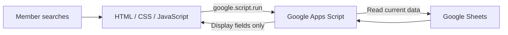

# CUDC Member Status

**A mobile-first membership status portal for Chulalongkorn University Dance Club.**

เว็บสำหรับให้สมาชิกประมาณ 300 คนตรวจสอบสถานะและกิจกรรมของตนเอง ผ่านหน้าเว็บที่เชื่อมกับ Google Sheets ของชมรม โดยไม่ต้องค้นข้อมูลในตารางด้วยตัวเอง

**Tech stack:** HTML · CSS · JavaScript · Google Apps Script · Google Sheets  
**Interface:** English · Mobile-first · Responsive desktop

## Problem & solution

ข้อมูลกิจกรรมและสถานะถูกอัปเดตใน Google Sheets อยู่เสมอ โปรเจกต์นี้จึงสร้างช่องทางให้สมาชิกค้นข้อมูลด้วยรหัสนิสิตหรือเบอร์โทร และดูผลจากข้อมูลล่าสุดที่บันทึกไว้ พร้อมรองรับกรณีข้อมูลตรงกันหลายคน

## Features

- ค้นด้วยรหัสนิสิตหรือเบอร์โทรแบบเต็ม พร้อมจัดการรูปแบบขีด ช่องว่าง เลขไทย และ +66
- แสดงสถานะจากชีต จำนวน Dancer, Staff และ Workshop พร้อมรายการกิจกรรม สำหรับ Choreo ใช้ข้อมูลจากแท็บ Choreo
- อ่านข้อมูลใหม่ทุกครั้งที่ค้น พร้อมสถานะกำลังโหลด ข้อความไม่พบข้อมูล และข้อความเมื่อเกิดข้อผิดพลาด
- Responsive UI ใช้ภาพพื้นหลังที่เหมาะกับมือถือและ Desktop พร้อมแสดงวันอัปเดตจากชีต

## How it works

## Development & collaboration

พัฒนาและปรับปรุงจากโจทย์ของชมรม ผ่านการกำหนดความต้องการ ออกแบบ mobile-first ทดลองใช้งาน และปรับแก้จาก feedback โดยใช้ AI ช่วยในการพัฒนาและทดสอบโค้ด

## Testing & limitations

- **19 automated checks** ทดสอบ backend ด้วยข้อมูลสมมติและ SpreadsheetApp จำลอง รวมถึงรูปแบบเบอร์ ข้อมูลซ้ำ Workshop และ Choreo
- ทดสอบ `/exec` เบื้องต้นด้วยคำค้นที่ไม่พบ **10 คำขอจาก 10 แท็บในเบราว์เซอร์เดียว** ได้ผลตอบกลับครบ การทดลองนี้ไม่ใช่การทดสอบผู้ใช้ 300 คนพร้อมกัน
- มีการตรวจผล Workshop หนึ่งรายกับไฟล์ชีตตัวอย่าง และผู้พัฒนายืนยันว่าทดสอบ Choreo แล้ว; ควรตรวจบัญชีผู้ใช้อื่นและข้อมูลจริงก่อนเผยแพร่ในวงกว้าง
- ระบบไม่มีการล็อกอิน ผู้ที่รู้รหัสนิสิตหรือเบอร์โทรของผู้อื่นอาจค้นดูข้อมูลที่เว็บแสดงได้ หมายเลขที่ใช้ค้นถูกส่งไป backend แต่ไม่ส่งกลับในผลลัพธ์
- ช่องกิจกรรมว่างไม่ยืนยันว่าไม่ได้เข้าร่วม และ Last updated อ้างอิงค่าที่กรอกใน `ชีต4!B10` ไม่ใช่เวลาที่ระบบตรวจจับเอง

## Future improvements

- ทดสอบการใช้งานพร้อมกันด้วยอุปกรณ์และบัญชีที่หลากหลาย พร้อมบันทึกความเร็วและข้อผิดพลาด
- ทบทวนวิธีตรวจสอบตัวตนกับผู้ดูแล หากต้องจำกัดการเข้าถึงข้อมูลให้เฉพาะเจ้าของ
- เพิ่มภาพตัวอย่างการใช้งานที่สร้างจากข้อมูลสมมติสำหรับผู้พิจารณา portfolio

## ติดตั้งใน Google Apps Script

1. สร้างโปรเจกต์ Apps Script ด้วยบัญชีที่มีสิทธิ์อ่าน Google Sheets ที่ต้องการ
2. คัดลอก `Code.gs` ไปใส่ไฟล์สคริปต์ และสร้างไฟล์ HTML ชื่อ `Index` จาก `Index.html`
3. เปิด **Project Settings → Show appsscript.json** และคัดลอก `appsscript.json` หากต้องการใช้การตั้งค่าเดียวกัน
4. ตรวจ `CUDC_CONFIG` ใน `Code.gs` ให้ตรงกับ spreadsheet และแท็บ `Attendance`; แท็บ `Choreo` และ `ชีต4` ต้องมีโครงสร้างที่โค้ดรองรับ
5. กด **Deploy → New deployment → Web app** เลือกให้รันในบัญชีผู้ deploy และกำหนดสิทธิ์ผู้เข้าใช้ตามที่ต้องการ จากนั้นอนุญาตสิทธิ์ตามที่ Google แสดง
6. ทดสอบด้วยลิงก์ `/dev` และทดสอบลิงก์ `/exec` ด้วยบัญชีที่ไม่มีสิทธิ์เปิดชีต ก่อนส่งให้สมาชิก

Spreadsheet ID และ LINE ติดต่อที่อยู่ในซอร์สเป็นข้อมูลที่มองเห็นได้ใน public repository ควรเปลี่ยนให้ตรงกับผู้ดูแลก่อนนำไปใช้เอง และไม่อัปโหลดไฟล์ข้อมูลสมาชิกขึ้น GitHub

## อัปเดตเว็บที่ deploy แล้ว

หลังแก้โค้ด ให้วางไฟล์ที่เปลี่ยนลง Apps Script และบันทึก จากนั้นเลือก **Deploy → Manage deployments → Edit → New version → Deploy** เพื่ออัปเดต deployment เดิม การ push ขึ้น GitHub เพียงอย่างเดียวไม่ได้อัปเดตเว็บ `/exec`

## ทดสอบ

ใช้ Node.js รัน `node test-identifiers.cjs` เพื่อทดสอบการค้นด้วยข้อมูลสมมติและ SpreadsheetApp จำลอง ผลทดสอบนี้ไม่ยืนยันการเชื่อมต่อ Google Sheets จริง สิทธิ์ผู้ใช้อื่น หรือประสิทธิภาพเมื่อมีผู้ค้นพร้อมกัน

อย่านำรหัสนิสิต เบอร์โทร รายชื่อ หรือไฟล์ชีตจริงมาใส่ใน tests, issues หรือ commit ของ repository
